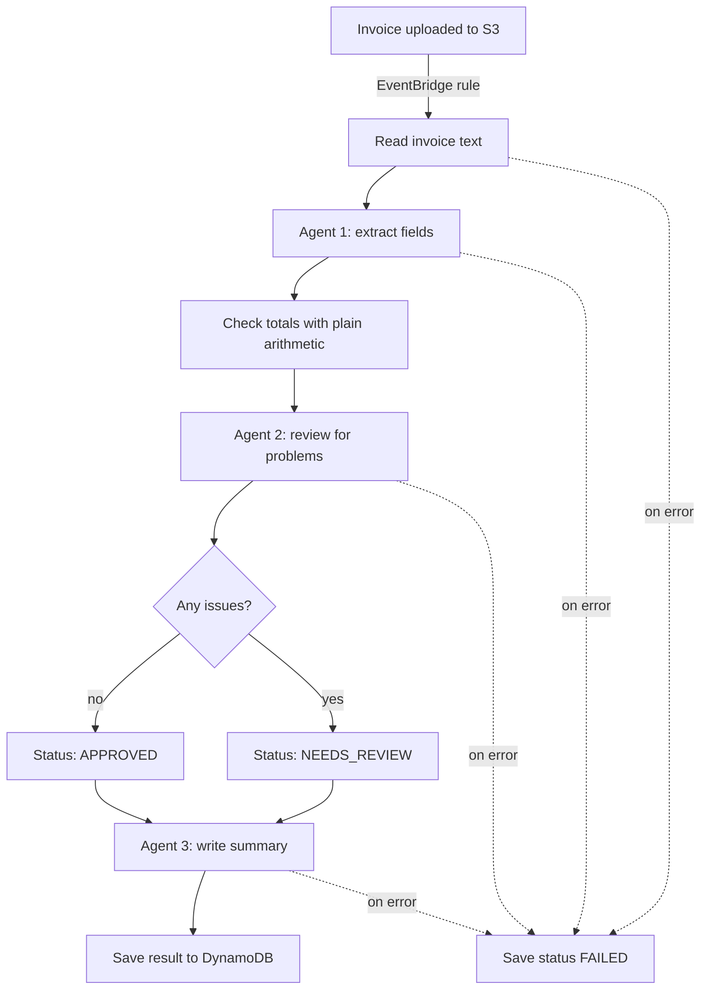

# AWS Invoice Processing Agents

A serverless workflow where three small AI agents process supplier invoices.

You drop an invoice into an S3 bucket. An AWS Step Functions workflow reads
it, extracts the fields, checks it for problems, writes a short summary, and
saves the result to DynamoDB. Invoices with problems are marked for a person
to review.

There are no Lambda functions and no servers. Step Functions calls Amazon
Bedrock, S3 and DynamoDB directly.

## How it works



| Step | What it does |
|---|---|
| Extract agent | Reads the invoice text and returns the fields as JSON: supplier, invoice number, dates, currency, line items, subtotal, tax and total. |
| Check totals | Checks that the line items add up to the subtotal and that subtotal plus tax equals the total. This is plain arithmetic in the workflow, not a model call. |
| Review agent | Looks for problems a rule cannot catch, such as a missing invoice number or a due date before the invoice date. |
| Summary agent | Writes two or three sentences for the person who approves payments. |

Each agent is one call to a model on Amazon Bedrock with its own prompt. The
prompts are plain text files in `prompts/`.

## Sample invoices

The `sample_invoices/` folder has three made-up invoices that show the
different paths through the workflow:

| File | What is in it | Expected status |
|---|---|---|
| `clean_invoice.txt` | A correct invoice | `APPROVED` |
| `wrong_totals_invoice.txt` | Line items add up to 1435.00 but the subtotal says 1535.00 | `NEEDS_REVIEW` |
| `bad_date_invoice.txt` | No invoice number, and the due date is before the invoice date | `NEEDS_REVIEW` |

## Project layout

| Path | What it is |
|---|---|
| `infra/workflow.py` | The Step Functions workflow, one block per step. |
| `infra/stack.py` | All AWS resources, written with AWS CDK in Python. |
| `prompts/` | The system prompt for each of the three agents. |
| `sample_invoices/` | Made-up invoices used as demo data. |
| `scripts/process_invoice.py` | Uploads an invoice and prints the result. |
| `tests/` | Unit tests. They run without an AWS account. |

## Design choices

- **Arithmetic is not left to a model.** Language models can make mistakes
  with numbers. The totals are checked with exact arithmetic in the workflow,
  and the agents are used only for reading and judgement.
- **Small agents with one job each.** Each agent has a short prompt and a
  narrow task. That makes each one easy to test, change, or replace.
- **Structured output through tools.** The extract and review agents answer
  through a tool with a fixed schema, so the workflow gets JSON it can use.
- **Any Bedrock model.** The workflow uses the Bedrock Converse API, which has
  one request format for all models. Changing the model is a deploy setting,
  not a code change.
- **No Lambda functions.** Step Functions calls Bedrock, S3 and DynamoDB
  itself. There is no application code to patch, package, or keep warm.
- **Nothing is lost.** Each step retries twice. If it still fails, the invoice
  is saved with the status `FAILED` and the error message.
- **Least privilege.** The workflow role has three permissions: read objects
  from the invoice bucket, put items in the results table, and call the model.
- **Pay per use.** Nothing runs when no invoices arrive. Processing one
  invoice costs roughly one US cent, almost all of it for the model calls.

## Run the tests

You need Python 3.13 and Node.js 22 or newer. Node.js is used by AWS CDK.

```bash
python -m venv .venv
source .venv/bin/activate        # on Windows: .venv\Scripts\activate
pip install -r requirements-dev.txt
ruff check .
pytest
```

The tests check the shape of the workflow and run its expressions (the totals
check, the routing, and the DynamoDB mapping) with a local JSONata library.

## Deploy

You also need:

- An AWS account with credentials set up for the AWS CLI.
- The AWS CDK CLI: `npm install -g aws-cdk`.
- Access to the model you want to use in Amazon Bedrock, in the region you
  deploy to.

```bash
# Run 'cdk bootstrap' once per account and region
cdk bootstrap
cdk deploy
```

Process a sample invoice:

```bash
python scripts/process_invoice.py sample_invoices/wrong_totals_invoice.txt
```

The script uploads the file, waits for the workflow, and prints the status,
the issues that were found, and the summary. You can also watch each step run
in the Step Functions console.

### Choose a model

The default model is Claude Haiku 4.5. You can use any text model on Amazon
Bedrock instead, from Anthropic, Amazon, Meta, Mistral or another provider.
Pass its model id or inference profile id when you deploy:

```bash
cdk deploy -c model_id=amazon.nova-lite-v1:0
```

List the model ids and inference profile ids in your region:

```bash
aws bedrock list-foundation-models --by-output-modality TEXT --query "modelSummaries[].modelId"
```

```bash
aws bedrock list-inference-profiles --query "inferenceProfileSummaries[].inferenceProfileId"
```

Two things to check for the model you pick:

- Your account has access to it in the region you deploy to.
- It supports tool use with the Bedrock Converse API. The extract and review
  agents return their results through a tool.

The model id that was used is saved with each result, so you can compare
models on the same invoices.

## What is saved

One item per invoice in the DynamoDB table:

| Attribute | Example |
|---|---|
| `invoice_key` | `clean_invoice.txt` |
| `status` | `APPROVED`, `NEEDS_REVIEW` or `FAILED` |
| `model_id` | The model that processed the invoice. |
| `supplier_name` | `Brightwater Office Supplies` |
| `invoice_number` | `BW-2026-0417` |
| `total`, `currency` | `913`, `USD` |
| `issues` | A list of short sentences. Empty when approved. |
| `summary` | The text written by the summary agent. |
| `fields` | All extracted fields as a JSON string. |
| `processed_at` | Time the workflow saved the result. |

## Limits

- **Text files only.** Without a Lambda function, Step Functions cannot pass
  a PDF or a scanned image to the model. See the next steps below.
- **Small files.** Step Functions passes at most 256 KB between steps, which
  is far more than a normal invoice.
- **Same file name, same record.** Uploading a file with the same name again
  replaces the earlier result.

## Remove everything

```bash
cdk destroy
```

This deletes all resources, including the invoice bucket and its contents.

## Possible next steps

- Read PDF and scanned invoices with Amazon Textract before the extract step.
- Pause the workflow on `NEEDS_REVIEW` and wait for a person to approve or
  reject, using a Step Functions task token.
- Match each invoice against a purchase order before approval.
- Send a notification with the summary through Amazon SNS.
- Add a set of labelled invoices to measure extraction accuracy over time.

## License

MIT. See [LICENSE](LICENSE).
